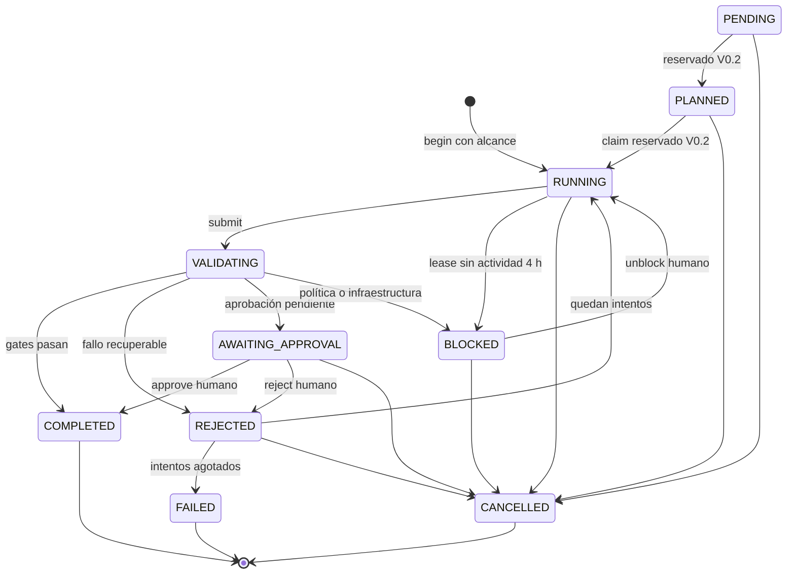

# Agentes y tareas

Un rol es una definición, no un proceso de Foker (FOKER-SPEC §12, ADR-011). El anfitrión ejecuta
el LLM y sus subagentes; Foker guarda estado y evidencia por `task_id`.

| Rol | Estado y responsabilidad |
|---|---|
| Implementer | MVP: `roles/implementer.md`; begin → context → editar → check → submit. No aprueba. |
| Reviewer | MVP consultivo: `roles/reviewer.md`; lectura del diff, reglas y skill; comentarios Markdown. Su juicio no es gate ni cambia estados. |
| Validation | MVP determinista: `packages/engine/src/tasks/gates.ts`; ejecuta checks confiados y registra evidencia. No es LLM. |
| Planner | PENDIENTE V0.2 (§12.2; sin issue FKR asignado en el backlog): propone tareas PENDING y alcance para revisión. |
| Architect | PENDIENTE V0.2 (§12.2; sin issue FKR asignado): propone ADRs/estructura desde foker.md, con aprobación humana. |

Sync exporta los dos roles MVP: subagentes en Claude Code/OpenCode y reglas en Antigravity.
Su comportamiento real depende del anfitrión: **PENDIENTE FKR-070**, ver [integraciones](integrations/README.md).
El handoff usa `task_id` y ledger, no memoria privada del agente.

## Máquina de estados

`packages/engine/src/tasks/fsm.ts` define las transiciones. Begin del MVP exige alcance y crea RUNNING;
PENDING/PLANNED están representados, pero planificación/claim quedan para V0.2.

## Qué significa COMPLETED

REQ-TSK-001 se evalúa sobre el árbol al enviar la tarea, con baseline autenticado:

| Gate | Condición implementada |
|---|---|
| G1 scope | Cambios dentro de scope y permisos de skill. Los borrados fuera de alcance pueden requerir aprobación; otros cambios fuera fallan. |
| G2 policy | Sin rutas protegidas ni secretos detectados; dependencias, lockfiles y rutas de aprobación requieren humano. Rutas protegidas o secretos bloquean. |
| G3 map | Refresco sin error y ningún archivo cambiado con parseStatus failed. No equivale a typecheck: partial no falla por sí solo. |
| G4 checks | Todos los checks declarados por el perfil pasan dentro del timeout. |
| G5 skill | Checks de la skill pasan; sin skill se registra skipped. |

Además, se escribe evidencia inmutable y se enlaza su hash en el evento. AWAITING_APPROVAL requiere
que no haya fallos ni bloqueos; approve humano completa la tarea con evidencia aprobada, sin volver
a ejecutar checks. Para comprobar el árbol actual usa `foker task verify <id>`: reevalúa y compara
la evidencia, sin modificar la tarea. COMPLETED no garantiza ausencia de vulnerabilidades desconocidas.

## Reintentos

Default: 3 intentos, configurable 1–5. REJECTED es transitorio: genera evento y prepara RUNNING
con intento incrementado, o FAILED al agotar el máximo. Submit puede devolver REJECTED aunque
status ya muestre RUNNING. Los hallazgos guían la autocorrección.
Un proceso que no llegó a ejecutarse bloquea con FKR-VAL-004 sin consumir intento; un timeout
tras arrancar falla el check y consume intento. Unblock humano permite continuar y cambiar alcance.
El lease de 4 h se comprueba al leer/listar y antes de mutar. Más detalles de locks, baseline,
aprobaciones e integridad local: [tasks.md](tasks.md).
