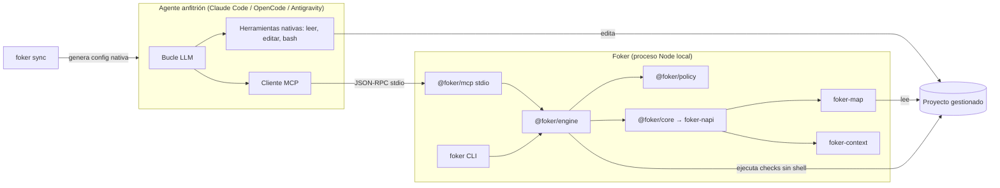

# Arquitectura de Foker

Resumen de FOKER-SPEC §4, §6 y §7. La especificación es la fuente normativa.

## Visión general



Foker no ejecuta el bucle LLM en el MVP. El agente anfitrión llama a las herramientas MCP de Foker y
edita con sus propias herramientas. Foker decide de forma determinista qué contexto ve el agente y si
una tarea está terminada.

## Módulos

| Módulo | Lenguaje | Responsable de |
|---|---|---|
| `crates/foker-map` | Rust | Descubrir archivos, parsear con tree-sitter, resolver imports (oxc_resolver), grafo, PageRank global, hash BLAKE3, persistencia atómica, normalización de rutas |
| `crates/foker-context` | Rust | Context Packs deterministas: BM25, PageRank personalizado, selección, renderizado, estimación de tokens |
| `crates/foker-napi` | Rust | Bindings napi-rs; sin lógica de dominio |
| `@foker/core` | TS | Carga del addon nativo y comprobación de versión exacta |
| `@foker/schemas` | TS | JSON Schemas, tipos generados y validadores (fuente única) |
| `@foker/policy` | TS | Rutas protegidas, aprobaciones, secretos, filtrado de entorno, workspace trust, ejecución segura de procesos |
| `@foker/engine` | TS | Configuración, ledger de tareas + FSM, gates, perfiles de validación, Skills, auditoría |
| `@foker/integrations` | TS | Generadores deterministas para Claude Code, OpenCode y Antigravity |
| `@foker/mcp` | TS | Servidor MCP stdio: protocolo, validación, límites, logging |
| `foker` | TS | CLI: argumentos, salida humana/JSON, exit codes |

Grafo de dependencias permitido (REQ-REPO-001, verificado por `pnpm check:deps`):

```text
Rust:   foker-map ──► foker-context ──► foker-napi
TS:     @foker/core (addon)
        @foker/schemas ◄── @foker/policy ◄── @foker/engine ◄── @foker/mcp ◄── foker (cli)
        @foker/core ◄── @foker/engine
        @foker/schemas ◄── @foker/integrations ◄── foker (cli)
```

## Frontera Rust / TypeScript

Rust contiene todo lo que procesa el árbol completo del repo o debe ser determinista bit a bit.
TypeScript contiene lo que habla con humanos, procesos y protocolos.

| Rust | TypeScript |
|---|---|
| Recorrido de archivos, globs, `.gitignore` | Lectura y validación de `foker.config.yaml` y `foker.md` |
| Parseo tree-sitter y extracción de símbolos | Servidor MCP y CLI |
| Resolución de módulos | Políticas, aprobación, workspace trust |
| Grafo, PageRank, BM25 | Ejecución de checks |
| Selección y renderizado del Context Pack | FSM de tareas, ledger, evidencia, auditoría |
| Hash BLAKE3, persistencia atómica, lock | Generadores de integraciones |
| Normalización y validación de rutas | Escaneo de secretos del diff |

Reglas de la frontera (FOKER-SPEC §7):

- Estructuras pequeñas como objetos napi; el mapa completo como string JSON canónico.
- Rutas siempre como ids normalizados POSIX relativos al root; nunca rutas absolutas en resultados.
- Errores con `error.code` (`FKR-…`); un pánico se convierte en `FKR-INT-001`.
- Funciones `async` en el runtime de napi-rs; nunca bloquean el hilo de Node.
- `@foker/core` exige que la versión del addon coincida exactamente con la del paquete (REQ-NAPI-003).

## Flujo de una tarea (MVP)

1. El anfitrión llama a `foker_task_begin` con descripción y alcance. Foker crea la tarea (`RUNNING`) y captura un baseline.
2. Llama a `foker_context` y recibe un Context Pack.
3. Edita con sus herramientas nativas.
4. Opcional: `foker_check` para feedback rápido.
5. Llama a `foker_task_submit`. Foker ejecuta los gates y responde `COMPLETED`, `REJECTED`, `AWAITING_APPROVAL` o `BLOCKED`.
6. Si `AWAITING_APPROVAL`, la persona ejecuta `foker task approve <id>`.
